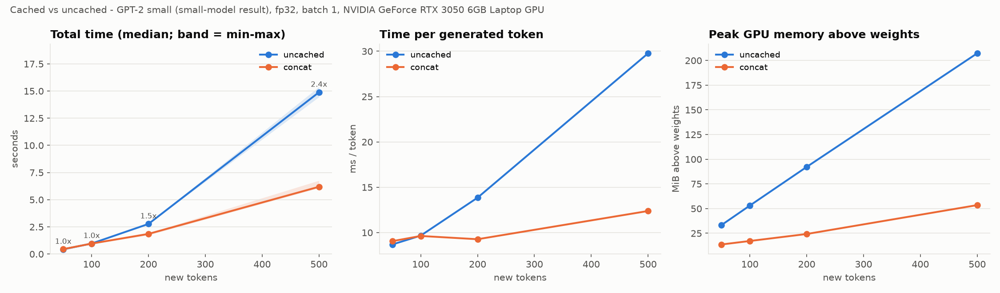
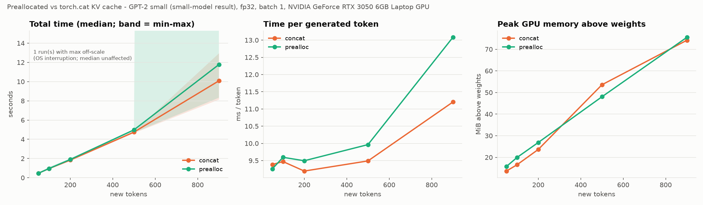
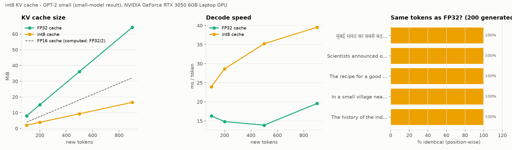
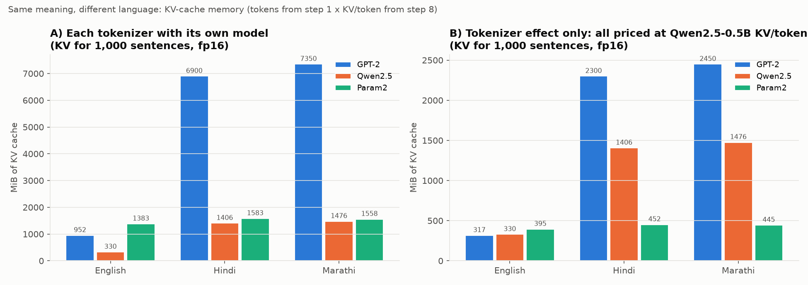

# Indic LLM Inference Lab

**Question:** What does it cost — in memory and time — to run (infer) an LLM, and why does it cost
more for Indian languages?

**Short answer (confirmed by the numbers below):** cost is paid *per token*. The same sentence in
Hindi or Marathi becomes several times more tokens under English-centric tokenizers, and every
token costs a slice of KV-cache memory and one decode step. Two levers fix it: better tokenizers
(fewer tokens) and leaner attention/caches (fewer bytes per token: GQA/MQA, int8 KV).

> Status: all 10 steps complete. Every number below comes from `results/*.csv`; every plot is drawn from
> those CSVs. `CONCEPTS.md` explains every idea simply, with interview questions per experiment.

## Key results at a glance
| Question | Answer (measured) |
|---|---|
| Extra tokens for the same Hindi text vs English | GPT-2 **7.25×** · Qwen2.5 **4.27×** · Param2 **1.15×** |
| KV memory for 1,000 Hindi sentences (FP16, GPT-2 shape) | **6.9 GB** vs 0.95 GB for English |
| KV-cache speed-up, GPT-2 small, 50 → 500 new tokens | **1.0× → 2.4×** (short runs are launch-overhead bound) |
| KV memory: formula vs measured | **exact** (72 KiB/token GPT-2 FP32; 12 KiB/token Qwen2.5 FP16) |
| int8 KV cache | **−74 %** vs FP32 (−48 % vs FP16), 100 % identical tokens on 5 prompts, but slower unfused |
| GQA / MQA at 8,192 tokens, batch 8 | KV/token **3× / 12× smaller**; decode **17.0 → 9.7 → 7.7 ms/step** |
| Param2-17B (MoE) weights | **31.95 GiB** BF16 (all 64 experts held), ~2.55 B params active per token |

## Hardware
Windows 11 laptop · NVIDIA GeForce RTX 3050 6GB **Laptop** GPU (compute capability 8.6, 20 SMs,
~5 GiB free after the desktop) · Python 3.14.2 · torch 2.15.0+cu132 · transformers 5.23.0.
(`results/env_check.txt`)

## How to reproduce (Windows PowerShell, from this folder)
```powershell
powershell -ExecutionPolicy Bypass -File .\setup_env.ps1    # venv + torch(CUDA) + libs + env check
.\.venv\Scripts\hf auth login                                 # needed for gated FLORES+
.\run.ps1 1        # step 1: token counts (no GPU needed)
.\run.ps1 tests    # correctness gate: GPT-2 == HF, cached == uncached == HF generate
.\run.ps1 all      # tests again, then steps 2..9 (stops if anything fails)
```
Each run writes a UTF-8 log to `results/logs/`. Plots are always regenerated from CSVs
(`run.py --plot-only`).

## Layout
```
src/          gpt2_scratch.py  kv_cache.py  attention.py  memory_model.py  bench.py  common.py  plotstyle.py
experiments/  NN_name/run.py + NOTES.md (prediction written before running, then result + why)
tests/        test_gpt2_matches_hf.py  test_kv_cache_equivalence.py  test_attention_gqa.py
results/      *.csv (every row carries GPU, torch version, model, precision, batch, seq len, date)
plots/        *.png (made from the CSVs only)
```

## Results

### 1. Same meaning, different token cost


Tokens needed for the same 200 FLORES+ sentences, relative to English with the same tokenizer:

| Tokenizer | Hindi | Marathi |
|---|---|---|
| GPT-2 | 7.25× | 7.72× |
| Qwen2.5 | 4.27× | 4.48× |
| Param2 | 1.15× | 1.13× |

A tokenizer that never learned Devanagari spends **less than one character per token** (GPT-2: 0.66).
Param2 makes Hindi almost as cheap as English, but its English costs ~20 % more tokens than GPT-2's
(vocabulary is a fixed budget). Details: `experiments/01_token_counts/NOTES.md`.

### 2–3. Correctness first
- **From-scratch GPT-2 = Hugging Face**: max logit difference 4.6e-5 – 1.1e-4 (FP32), always smaller
  than HF's own CPU-vs-GPU difference (1.2e-4 – 2.3e-4); identical next-token predictions.
- **KV cache**: greedy uncached = cached (torch.cat) = cached (preallocated) = HF `generate` for
  200 tokens (100 % identical). Giving new tokens position 0 (the classic bug) breaks the output at
  the very first decode step (4 % identical, degenerates into ",,,,,").

### 4. Speed and memory: cached vs uncached (GPT-2 small, FP32, batch 1 — small-model result)


| new tokens | uncached | cached | speed-up |
|---|---|---|---|
| 50 | 434 ms | 453 ms | 0.96× |
| 200 | 2.77 s | 1.85 s | 1.49× |
| 500 | 14.9 s | 6.19 s | 2.40× |

At 50 tokens both cost ~9 ms per token even though uncached does far more maths: the step time is fixed
overhead (Python + hundreds of small kernel launches), not computation. KV memory matched
2 × layers × heads × head_dim × tokens × bytes **exactly**; uncached used 3.9× more peak memory at 500 tokens
(it recomputes logits for every position each step).

### 5. Preallocated cache


No measurable speed difference (−1 % … +5 %, interleaved timing). The copy saved is < 1 ms per ~10 ms step.
Preallocation's real value is predictable memory (no growth, no fragmentation) — the idea behind paged KV caches.

### 6. int8 KV cache


Exactly 74.2 % smaller than FP32 (66 bytes per 64 numbers vs 256). All 1,000 generated tokens (5 prompts × 200)
identical to the FP32 cache; ~0.6 % reconstruction error. 1.5–2.5× slower here because dequantization is not
fused into attention.

### 7. MHA vs GQA vs MQA (random weights — cost only, no quality claims)


KV per token 36 / 12 / 3 KiB. Up to ~1,000 tokens every variant costs ~7.5 ms/step (overhead floor); at 8,192
tokens decode becomes memory-bound: MHA 17.0, GQA 9.7, MQA 7.7 ms/step. Copying K/V to all heads
(`repeat_interleave`) is 2.8× slower than MHA — the classic GQA implementation trap.

### 8. Memory calculator
Reads any HF `config.json` (handles missing `num_key_value_heads` / `head_dim`, MoE, MLA).
Calculator = measurement for GPT-2 (124.4 M params, 474.7 MiB FP32, 73,728 B KV/token) and Qwen2.5-0.5B
(494.0 M, 942.3 MiB FP16, 12,288 B KV/token). Param2 from config only: 17.15 B params (matches the Hub to
0.00002 %), 42 KiB KV/token. Found along the way: the Hub's 137.0 M for GPT-2 includes 12 stored
1024 × 1024 causal masks.

### 9. Putting it together: KV memory of the same text, per language


KV memory = tokens × bytes per token, so the two levers multiply. Holding KV/token fixed (right panel),
Hindi costs 7.3× English under GPT-2's tokenizer and 1.15× under Param2's. With each tokenizer's own model
(left), Qwen's GQA (2 KV heads) makes its Hindi KV smaller than Param2's despite 3.1× more tokens.

## Limitations
These results are honest but narrow. **Speed and memory were measured on GPT-2 small (124 M)** — a tiny,
English-only model that cannot understand Hindi; we measured only the cost of processing tokens, never output
quality. Absolute timings come from **one Windows laptop GPU** (RTX 3050 6GB Laptop), where kernel-launch overhead
is large and clock speed drifts; we used warm-up, synchronization, medians and interleaving, but two timed runs
were still interrupted by the OS (visible as off-scale maxima), and differences under ~5 % should be read as
"no measurable difference". Bigger models on server GPUs are more compute- and bandwidth-bound, so the cache
and GQA benefits would show at shorter lengths there. The language comparison uses **200 sentences from one
dataset (FLORES+ `dev`)** — formal, encyclopedic text; chat, code-mixed Hinglish or romanized Hindi would tokenize
differently. The per-language KV numbers for Qwen2.5 and Param2 are **arithmetic** (token counts × config-derived
KV/token), not measurements of those models running, and View A compares models of very different size and ability.
Our int8 cache is unfused (slower than FP32), the MHA/GQA/MQA study uses random weights (no quality claims), and
the int8 agreement test covers only 5 prompts with greedy decoding. Param2's weights were never downloaded.
