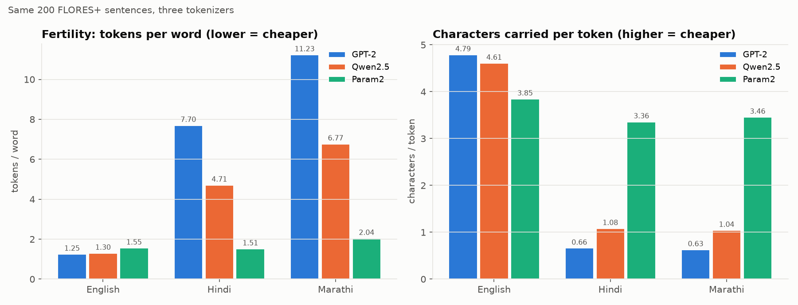
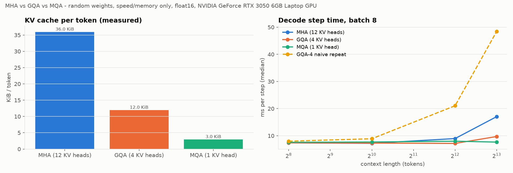

# Indic LLM Inference Lab

How much memory and time does it take to run an LLM, and why is it more expensive for Indian languages?

Most of the cost of inference is per token. Each token needs one decode step and its own slot in the KV cache. Tokenizers trained mostly on English split Hindi and Marathi text into far more tokens than English text with the same meaning, so the same request costs more. This repo measures that end to end. It covers the tokenizer gap, a GPT-2 written from scratch with a KV cache, a few cache optimizations, and a memory calculator that turns the token counts into megabytes.

## Summary

| What | Result |
|---|---|
| Tokens for the same Hindi text vs English | GPT-2 7.25x, Qwen2.5 4.27x, Param2 1.15x |
| KV cache for 1,000 Hindi sentences (FP16, GPT-2 dimensions) | 6.9 GB, vs 0.95 GB for English |
| KV cache speed-up, GPT-2 small, 50 to 500 new tokens | 1.0x to 2.4x |
| KV cache size, measured vs formula | Identical (72 KiB/token GPT-2 FP32, 12 KiB/token Qwen2.5 FP16) |
| int8 KV cache | 74% smaller than FP32 (48% vs FP16), same output on 5 test prompts, slower without a fused kernel |
| MHA / GQA / MQA at 8,192 tokens, batch 8 | 36 / 12 / 3 KiB per token, 17.0 / 9.7 / 7.7 ms per decode step |
| Param2-17B (MoE) weights | 31.95 GiB in BF16, about 2.55B parameters active per token |

## Setup

- Windows 11 laptop, NVIDIA RTX 3050 6GB Laptop GPU (about 5 GiB usable)
- Python 3.14.2, torch 2.15.0+cu132, transformers 5.23.0
- Full environment report: `results/env_check.txt`

## Running it

From PowerShell in the repo folder:

```powershell
powershell -ExecutionPolicy Bypass -File .\setup_env.ps1   # venv, CUDA torch, dependencies, env check
.\.venv\Scripts\hf auth login                                # FLORES+ is gated on Hugging Face
.\run.ps1 1        # token counts (CPU only)
.\run.ps1 tests    # correctness tests
.\run.ps1 all      # tests, then experiments 2-9; stops on the first failure
```

Logs go to `results/logs/`. To redraw any plot from its CSV, run that experiment with `--plot-only`.

## Layout

```
src/          gpt2_scratch.py, kv_cache.py, attention.py, memory_model.py, bench.py
experiments/  NN_name/run.py and NOTES.md (prediction written before running, then result and explanation)
tests/        test_gpt2_matches_hf.py, test_kv_cache_equivalence.py, test_attention_gqa.py
results/      CSVs; every row records GPU, torch version, model, precision, batch, sequence length, date
plots/        generated from the CSVs
```

## Results

### 1. Token counts



200 parallel sentences from FLORES+ (`dev` split) in English, Hindi and Marathi. Token counts relative to English, same tokenizer:

| Tokenizer | Hindi | Marathi |
|---|---|---|
| GPT-2 | 7.25x | 7.72x |
| Qwen2.5 | 4.27x | 4.48x |
| Param2 | 1.15x | 1.13x |

GPT-2 averages 0.66 characters per token on Hindi. Every Devanagari character is 3 bytes in UTF-8, and GPT-2 learned very few merges for those bytes, so many tokens hold only part of a character. Param2 gets Hindi close to English, but its English costs about 20% more tokens than GPT-2's, because vocabulary slots spent on Devanagari aren't available for English.

Qwen2.5 failed `decode(encode(text)) == text` on 27 of 200 Hindi sentences. All 27 come from its NFC normalizer, which splits precomposed nukta letters (U+0958 to U+095F) into a base letter plus U+093C. The text looks the same but the bytes differ.

### 2-3. Correctness

The from-scratch GPT-2 matches Hugging Face's logits to within 4.6e-5 to 1.1e-4 in FP32, with the same argmax at every position. For comparison, Hugging Face's own model differs between my CPU and GPU by 1.2e-4 to 2.3e-4, so the remaining gap is floating-point noise.

With greedy decoding, the uncached loop, the concat cache, the preallocated cache and HF `generate` all produce the same 200 tokens. Assigning new tokens position 0 instead of the cache length breaks generation at the first decode step.

### 4. Cached vs uncached (GPT-2 small, FP32, batch 1)


| New tokens | Uncached | Cached | Speed-up |
|---|---|---|---|
| 50 | 434 ms | 453 ms | 0.96x |
| 200 | 2.77 s | 1.85 s | 1.49x |
| 500 | 14.9 s | 6.19 s | 2.40x |

At 50 tokens both versions take about 9 ms per token, even though the uncached one does much more compute. That time is fixed per-step overhead (Python plus a few hundred small kernel launches), so the cache only pays off once the sequence is long. The measured cache size matches 2 x layers x heads x head_dim x tokens x bytes exactly. Without a cache, peak memory at 500 tokens is 3.9x higher, mostly because every step recomputes logits for every position.

### 5. Preallocated cache vs torch.cat


No measurable difference in speed (-1% to +5%, with the two methods timed alternately). The copy that preallocation avoids takes well under 1 ms against a step time of about 10 ms. On a model this small, the benefit is predictable memory use rather than speed.

### 6. int8 KV cache


Each 64-value vector is stored as 64 int8 values plus an FP16 scale, so 66 bytes instead of 256. That's 74.2% smaller than FP32. Over 5 prompts x 200 tokens, the output was identical to the FP32 cache, with about 0.6% reconstruction error. It runs 1.5-2.5x slower here because the whole cache is dequantized every step instead of inside the attention kernel.

### 7. MHA vs GQA vs MQA



Random weights, so these numbers are about cost only and say nothing about quality. With 12, 4 and 1 KV heads, the KV cache takes 36, 12 and 3 KiB per token. Up to about 1,000 tokens all three sit at roughly 7.5 ms per step. At 8,192 tokens decode is memory-bound and the gap shows: 17.0, 9.7 and 7.7 ms. Implementing GQA with `repeat_interleave` copies K and V back up to 12 heads, which made it 2.8x slower than MHA.

### 8. Memory calculator

`src/memory_model.py` reads any Hugging Face `config.json` and estimates weight memory and KV bytes per token. It handles missing `num_key_value_heads` and `head_dim`, MoE configs and MLA.

| Model | Params | Weights | KV/token |
|---|---|---|---|
| GPT-2 | 124.4M (measured = calculated) | 474.7 MiB FP32 | 73,728 B FP32 |
| Qwen2.5-0.5B | 494.0M (measured = calculated) | 942.3 MiB FP16 | 12,288 B FP16 |
| Param2-17B-A2.4B | 17.15B (config only) | 31.95 GiB BF16 | 42 KiB FP16 |

The Hub lists GPT-2 at 137.0M parameters. The extra 12.6M are the twelve 1024x1024 causal-mask buffers stored in the checkpoint, which aren't trainable weights.

### 9. KV memory per language


KV memory is tokens times bytes per token, so the tokenizer and the attention layout multiply. At a fixed KV size per token (right panel), Hindi costs 7.3x English with GPT-2's tokenizer and 1.15x with Param2's. With each tokenizer's own model (left panel), Qwen's GQA (2 KV heads) gives it a smaller Hindi KV cache than Param2, even though Qwen needs 3.1x as many tokens.

Per-experiment details, including the predictions I made before running each one, are in `experiments/*/NOTES.md`. Short explanations of the concepts are in `CONCEPTS.md`.

## Limitations

- **Small model only.** Speed and memory were measured on GPT-2 small (124M). It's an English model and can't understand Hindi, so these numbers cover processing cost only, not output quality.
- **One laptop GPU.** All timings come from a single laptop GPU on Windows, where kernel-launch overhead is high and clock speeds drift. I used warm-up runs, CUDA sync, medians and interleaved timing, but treat differences under about 5% as noise. Two timed runs were interrupted by the OS; they show up as off-scale maxima and don't affect the medians.
- **Narrow language data.** The comparison uses 200 sentences of formal text from one dataset. Chat text, Hinglish or romanized Hindi would tokenize differently.
- **Calculated, not measured.** The Qwen2.5 and Param2 numbers in step 9 come from token counts and config files, not from running those models. The two models also differ a lot in size and capability.
- **Limited optimization tests.** The int8 cache isn't fused, the attention-variant study uses random weights, and the int8 agreement check only covers 5 prompts with greedy decoding.
